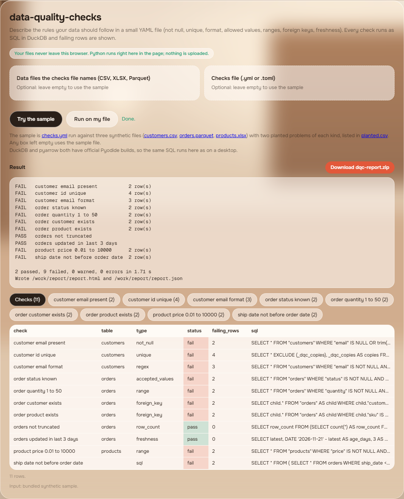
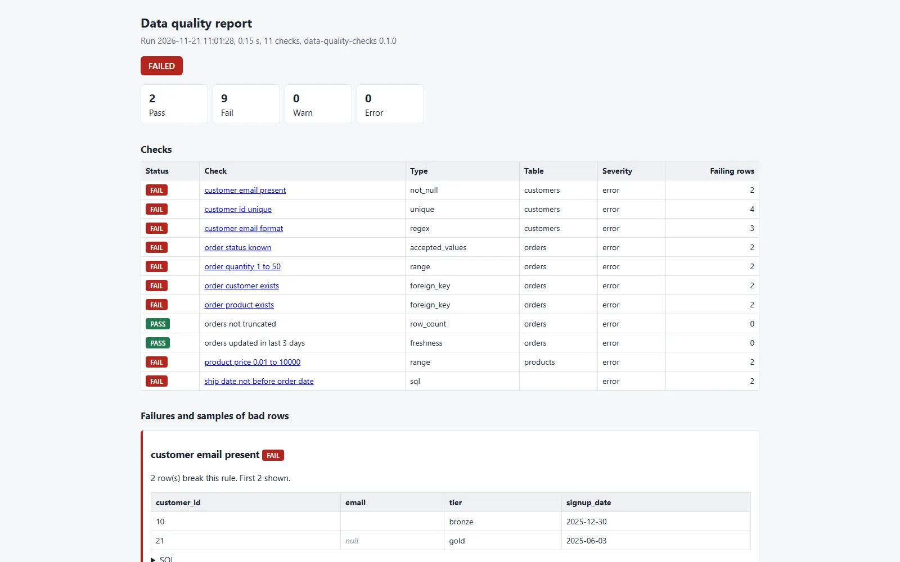

# data-quality-checks

[](https://github.com/chasebuilds/data-quality-checks/actions/workflows/ci.yml)  [](LICENSE)

**[Live demo: try it in your browser](https://chasebuilds.github.io/data-quality-checks/)**. Drop in your own file or run the bundled sample with one click. The real package runs in the page with Pyodide, so files never leave your browser.

[](https://chasebuilds.github.io/data-quality-checks/)

Checks CSV, Excel and Parquet files against rules written in a short YAML file, and writes a pass/fail report that shows the bad rows. Every rule is compiled to one DuckDB SQL query, and `--show-sql` prints it. The command exits non-zero when a check fails, so it can stop a pipeline or a CI job before bad data moves on.

## Measured result

Faults of known kinds were planted in generated files, and the checks were scored on what they caught. The table below is written by the benchmark script from a real run, not typed by hand. Method, misses and limits: [BENCHMARK.md](BENCHMARK.md).

<!-- benchmark:start -->
| Planted fault | Intended check | Planted | Caught by intended check | Catch rate |
|---|---|---:|---:|---:|
| blank_email | customer email present | 200 | 200 | **100.0%** |
| duplicate_customer | customer id unique | 200 | 200 | **100.0%** |
| bad_email | customer email format | 200 | 184 | **92.0%** |
| bad_status | order status known | 200 | 200 | **100.0%** |
| bad_quantity | order quantity 1 to 50 | 200 | 200 | **100.0%** |
| orphan_customer | order customer exists | 200 | 200 | **100.0%** |
| orphan_sku | order product exists | 200 | 200 | **100.0%** |
| ship_before_order | ship date not before order date | 200 | 200 | **100.0%** |
| bad_price | product price 0.01 to 10000 | 200 | 200 | **100.0%** |
| truncated_orders | orders not truncated | 20 runs | 20 | **100.0%** |
| stale_orders | orders updated in last 3 days | 20 runs | 20 | **100.0%** |
| plausible_quantity | (none) | 200 | 0 | **0.0%** |
| plausible_email | (none) | 200 | 0 | **0.0%** |

False alarms on clean data: 0 failing checks in 220 check runs. All 11 checks on 1,000,000 orders: 0.43 s.
<!-- benchmark:end -->

The last two rows are faults no rule can catch: a wrong value that still looks valid. They are there to show the limit. The 16 missed bad emails are the same kind of fault: a domain cut from `mail.example.net` to `mail.example` still looks like a real address. [LIMITATIONS.md](LIMITATIONS.md) covers both.



## A checks file

```yaml
tables:
  customers: customers.csv
  orders: orders.parquet
  products: { path: products.xlsx, sheet: Products }

checks:
  - name: customer email present
    table: customers
    type: not_null
    column: email
  - table: customers
    type: unique
    column: customer_id
  - table: orders
    type: accepted_values
    column: status
    values: [placed, shipped, delivered, returned]
  - table: orders
    type: range
    column: quantity
    min: 1
    max: 50
  - table: customers
    type: regex
    column: email
    pattern: '[a-z0-9._%+-]+@[a-z0-9-]+(\.[a-z0-9-]+)*\.[a-z]{2,}'
  - table: orders
    type: row_count
    min: 75
  - table: orders
    type: foreign_key
    column: customer_id
    references: customers.customer_id
  - table: orders
    type: freshness
    column: order_date
    max_age_days: 3
  - name: ship date not before order date
    type: sql
    query: SELECT * FROM orders WHERE ship_date < order_date
    severity: warn
```

Paths are relative to the checks file. TOML works too (`checks.toml`, same keys). Every check takes an optional `name` and `severity` (`error`, the default, or `warn`). Unknown keys and typos are rejected when the file is loaded, before anything runs.

| Type | Fails a row when | Keys |
|---|---|---|
| `not_null` | the value is null, empty or only spaces | `column`, `blank_is_null` (default true) |
| `unique` | the key appears more than once (every copy is listed) | `column` or `columns` |
| `accepted_values` | the value is not in the list (exact text match) | `column`, `values` |
| `range` | the value is below `min`, above `max`, or not a number | `column`, `min`, `max` |
| `regex` | the whole value does not match the pattern | `column`, `pattern` |
| `row_count` | the table has fewer than `min` or more than `max` rows | `min`, `max` |
| `foreign_key` | the value is not found in the referenced column | `column`, `references: table.column` |
| `freshness` | the newest date is more than `max_age_days` old | `column`, `max_age_days`, `as_of` |
| `sql` | any row is returned by the query | `query` |

## What it compiles to

`dqc run checks.yml --show-sql` prints the query behind each check. A check passes when its query returns zero rows. Two examples from the sample suite:

```sql
-- customer id unique
SELECT * EXCLUDE (_dqc_copies), _dqc_copies AS copies FROM (SELECT *, count(*) OVER (PARTITION BY "customer_id") AS _dqc_copies FROM "customers" WHERE "customer_id" IS NOT NULL) WHERE _dqc_copies > 1 ORDER BY "customer_id";

-- order customer exists
SELECT child.* FROM "orders" AS child WHERE child."customer_id" IS NOT NULL AND NOT EXISTS (SELECT 1 FROM "customers" AS parent WHERE CAST(parent."customer_id" AS VARCHAR) = CAST(child."customer_id" AS VARCHAR));
```

Column and table names must be plain names (letters, digits, underscore) and are quoted; values are escaped. Only the `sql` check runs text from the file as written.

## Quick start

Windows (on macOS or Linux use `.venv/bin/` in place of `.venv\Scripts\`):

```
python -m venv .venv
.venv\Scripts\python -m pip install -e .
.venv\Scripts\dqc run samples\checks.yml -o samples\report
```

The sample files have two planted problems of each kind, listed in [`samples/planted.csv`](samples/planted.csv). The last command prints:

```
FAIL   customer email present           2 row(s)
FAIL   customer id unique               4 row(s)
FAIL   customer email format            3 row(s)
FAIL   order status known               2 row(s)
FAIL   order quantity 1 to 50           2 row(s)
FAIL   order customer exists            2 row(s)
FAIL   order product exists             2 row(s)
PASS   orders not truncated
PASS   orders updated in last 3 days
FAIL   product price 0.01 to 10000      2 row(s)
FAIL   ship date not before order date  2 row(s)

2 passed, 9 failed, 0 warned, 0 errors in 0.15 s
Wrote samples\report\report.html and samples\report\report.json
```

`customer id unique` lists 4 rows because each of the two duplicated customers appears twice. `customer email format` lists 3 because one of the blank emails is a run of spaces, which is not a valid address either. A test checks that every planted row a check is meant to catch is in the report.

Options:

| Option | Effect |
|---|---|
| `-o DIR` | folder for `report.html` and `report.json` (default `dqc-report`) |
| `--sample N` | bad rows kept per failing check (default 5) |
| `--show-sql` | print the SQL for every check before running |
| `--as-of YYYY-MM-DD` | date that `freshness` measures from (default today) |
| `--strict` | `warn` checks also fail the run |
| `--no-report` | print results only |

Exit codes: `0` every error-severity check passed, `1` at least one failed or could not run, `2` the checks file or a data file could not be read.

In CI:

```yaml
- run: pip install git+https://github.com/chasebuilds/data-quality-checks
- run: dqc run checks/orders.yml -o dqc-report
- uses: actions/upload-artifact@v4
  if: always()
  with: { name: dqc-report, path: dqc-report }
```

As a library:

```python
from data_quality_checks import load_suite, run_suite

result = run_suite(load_suite("checks.yml"))
for r in result.results:
    print(r.check.name, r.status, r.failing_rows)
```

## The report

`report.html` is one page: a verdict, counts, a table of every check with its failing-row count, and for each failure a sample of the bad rows and the SQL that found them. `report.json` holds the same content for other tools. The sample report is in [`samples/report/`](samples/report/).

A check that cannot run (a misspelled column, for example) is reported as `ERROR` with DuckDB's message, and the other checks still run.

## How it works

1. **Parse and validate** the checks file: known check types, required keys, plain names, a regex that compiles, `min` not above `max`, referenced tables that exist.
2. **Load the files into DuckDB.** CSV through `read_csv_auto`, Parquet through `read_parquet`, Excel through openpyxl into an Arrow table. Nothing is copied to disk.
3. **Compile** each check to one query that selects the rows breaking the rule. Table-level checks (`row_count`, `freshness`) return one summary row when they fail.
4. **Run** `count(*)` over each query, then fetch the first N rows of the failing ones.
5. **Write** the HTML and JSON reports and set the exit code.

## Limits

Short version: a pass means no row broke a rule you wrote, not that the data is right. Plausible wrong values pass. Text comparisons are exact. No history, profiling or anomaly detection. The full list is in [LIMITATIONS.md](LIMITATIONS.md).

## Development

```
.venv\Scripts\python -m pip install -e ".[dev]"
.venv\Scripts\python -m pytest --cov
.venv\Scripts\python -m ruff check .
.venv\Scripts\python -m mypy
.venv\Scripts\python -m benchmark.run_benchmark
```

The sample files were made with `python -m benchmark.generate --out samples --seed 7`.

## License

MIT. See [LICENSE](LICENSE).

## More from Chase Builds

- **[react-analytics-dashboard](https://github.com/chasebuilds/react-analytics-dashboard)**: Sales and operations dashboard with filters, charts and CSV export. ([live demo](https://chasebuilds.github.io/react-analytics-dashboard/))
- **[housing-market-trends](https://github.com/chasebuilds/housing-market-trends)**: Monthly market metrics and a time-adjustment rate with a confidence band. ([live demo](https://chasebuilds.github.io/housing-market-trends/))
- **[automated-reporting-system](https://github.com/chasebuilds/automated-reporting-system)**: Weekly exports in, finished Excel report and dashboard out. Stops itself when the data looks wrong. ([live demo](https://chasebuilds.github.io/automated-reporting-system/))

[All projects, sorted by industry](https://github.com/chasebuilds) · [chasebuilds.github.io](https://chasebuilds.github.io)
